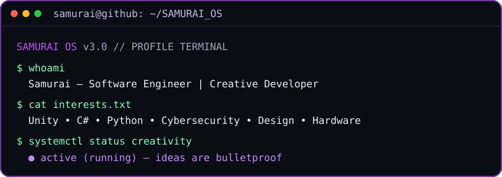

### Hello 👋, I'm Samurai

**Software Engineer · Developer · Technology Enthusiast · Brazil 🇧🇷**

🌱 Exploring cybersecurity, hardware, Arduino and creative development.

*Ideas are not just flesh and blood. Ideas are bulletproof.*

---

### 💻 Samurai OS // Terminal

---

### ⚡ Tools & Technologies

---

### 📊 GitHub Activity

---

---

### 👾 Commit Invaders

<picture>
  <source media="(prefers-color-scheme: dark)" srcset="https://raw.githubusercontent.com/tiosamu/tiosamu/output/commit-invaders-dark.svg" />
  <source media="(prefers-color-scheme: light)" srcset="https://raw.githubusercontent.com/tiosamu/tiosamu/output/commit-invaders.svg" />
  
</picture>

